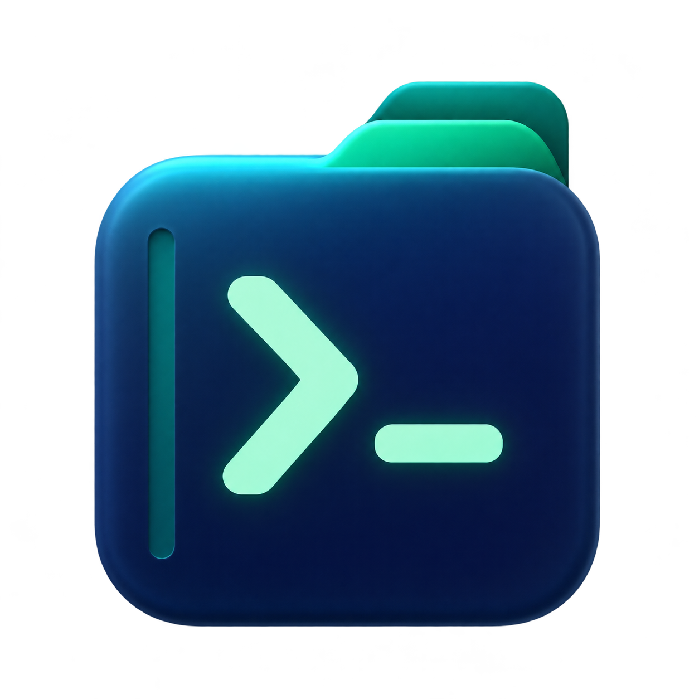

<p align="center"></p>

<h1 align="center">Tmux Workspace</h1>
<p align="center">A native Windows workspace for your Linux tmux sessions.<br>用 Windows 原生界面管理 Linux 服务器上的 tmux 会话。</p>

<p align="center"><a href="https://github.com/AconHol/tmux-workspace/releases/latest">下载 / Downloads</a> · <a href="TMUX-WORKSPACE.md">使用说明</a> · <a href="LICENSE">MIT</a></p>

## What it does

Choose a server, then open its tmux sessions from a permanent, collapsible sidebar. Each tab attaches to one session; tmux continues to manage windows and panes inside that session. This is an independent fork of [Windows Terminal](https://github.com/microsoft/terminal), based on v1.25.3131.0. It is not an official Microsoft product.

- Paste an SSH command or use an existing SSH config alias. Uses Windows OpenSSH, local keys, known_hosts and ssh-agent.
- Create sessions, search the session list, or select an existing session. Duplicate names remain editable and can open the existing session.
- A session has one app tab across all windows. Clicking it elsewhere activates the original window and tab, including a minimized window.
- Drag a tab into a new window without losing the SSH connection or terminal buffer.
- Collapse the native sidebar to a compact icon rail. Theme, font, color scheme, background opacity, acrylic and image customization are available.
- Sidebar shortcuts control real tmux splits, pane focus, zoom, windows, layouts and history, including from the compact rail.
- Choose Native, Compatibility or Off under Personalization → Pane Mouse and Touch. Native mode supports tmux mouse clicks, resizing and scrolling. Compatibility mode selects clicked panes over SSH with tmux mouse off. Both modes support touchscreen taps to focus a pane and keep the terminal's swipe gesture for scrolling. The preference is saved locally and applies to existing and reconnected sessions.
- On a touchscreen, hold a word to select it, drag across lines, then tap Copy. Text selection stays inside the tmux pane where it began, even when the pointer crosses a divider. For mouse selection with tmux mouse reporting on, hold Shift while dragging.
- Right-click or touch and hold inside a tmux pane, then choose **Copy this pane**. This copies the pane under the pointer, including the visible screen and up to 500 prior lines. Closing the menu clears the text highlight. In Native mouse mode, the terminal forwards wheel input to tmux and other programs that request mouse reporting.
- Translate your own text with a configurable OpenAI-compatible API and insert it into the original terminal. Choose the target language, endpoint and model; the API key is encrypted with Windows DPAPI. Press Enter yourself to submit the inserted text.
- If tmux is missing, the app offers an explicit install action in an interactive SSH terminal.
- No fixed five-second polling. Refresh manually or after relevant workspace operations.
- Editable forms stay in the main XAML Island with native WinUI controls. UWP ContentDialog text input is unsupported in that host, so the app does not use its popup surface for editable forms.

## 下载与使用

需要 Windows 11 x64 和系统 OpenSSH 客户端；服务器需要 Linux 和 tmux。使用密钥、SSH config 或 ssh-agent 登录。加密密钥请先加载到 agent。

1. 在 [Releases](https://github.com/AconHol/tmux-workspace/releases/latest) 下载 ZIP 便携包，解压后运行 WindowsTerminal.exe，保留同目录的 DLL、资源文件和 .portable 文件。便携包不需要导入证书。
2. 选择自动发现的 SSH 服务器，或点击“添加服务器”粘贴 `ssh user@host -p 22`。本机主机密钥尚未确认时，从 SSH 终端核实后再管理会话。
3. 从侧栏选择或新建会话。点击已经打开的会话会跳转到原窗口；关闭标签页只断开 SSH，服务器上的任务继续运行。
4. MSIX 安装包使用本地开发者证书签名，不是微软商店或公共受信证书。该证书已受你信任的设备可安装；在其他设备上请先核验发布者和公钥证书。不要忽略签名警告。

应用不保存 SSH 密码、不复制私钥、不读取其他 SSH 软件的密码库，也不会自动接受未知主机密钥。翻译只发送你在面板中填写的原文，API Key 使用 Windows 当前用户加密保存。运行配置不包含在发布包中。

## Build from source

Use a Visual Studio developer environment with C++ desktop, UWP/MSIX build tools, Windows SDK 10.0.26100.0, PowerShell 7 and a supported .NET SDK. The upstream solution and pinned NuGet packages are retained. The current release was built with Visual Studio 2026 / MSVC 14.51.

```powershell
pwsh -File tools/Build-TmuxWorkspace.ps1 -OutputDirectory C:/build/TmuxWorkspace
pwsh -File tools/Test-TmuxWorkspace.ps1
```

For a signed MSIX, use your own certificate in CurrentUser/My. Set the Publisher in TmuxWorkspace.appxmanifest to that certificate's Subject before building; never commit its private key.

```powershell
pwsh -File tools/Build-TmuxMsix.ps1 -OutputDirectory C:/build/installer -CertificateThumbprint YOUR_CERTIFICATE_THUMBPRINT
```

The app icon source and Windows variants are in [res/tmux-workspace](res/tmux-workspace). Regenerate scale variants with `pwsh -File tools/Generate-TmuxIcons.ps1`.

## Validation and scope

The functional workspace was exercised against a real Linux server with tmux 3.6 using the actual TerminalPage and TermControl, including session creation, output rendering, form focus, opacity, tab tear-out, cross-window activation, simultaneous open requests and owner-close/reopen. Form regression checks queue native WM_CHAR/key messages and verify resulting text, dismissal and remote creation; they do not only assign Text properties. Low-opacity acrylic and maximized layout are also exercised. Full physical keyboard/mouse, IME composition and visual accessibility acceptance is not claimed. See Microsoft's [XAML Islands limitations](https://learn.microsoft.com/en-us/windows/apps/desktop/modernize/xaml-islands/xaml-islands).

```powershell
# Creates and cleans up test-owned sessions on the specified server.
# Use a disposable server; your SSH configuration must authenticate non-interactively.
pwsh -File tools/Test-TmuxWorkflow.ps1 -SshCommand 'ssh my-test-server' -WorkDirectory C:/build/workflow
```

The dedicated workflow build contains a test driver. Always rebuild normally before packaging a release; the packaging script rejects the test driver.

Each window manages one server and its default tmux socket for the SSH user. Custom `tmux -L/-S` sockets are not supported. Session identity uses the tmux server PID, session ID and creation time. Cross-window deduplication applies within one running application instance and the same saved SSH connection; different aliases to the same host and independently running copies are not merged. Switching sessions manually inside tmux does not rebind the app tab.

## License and upstream

[MIT](LICENSE). The original Microsoft copyright and [third-party notices](NOTICE.md) are retained. Tmux Workspace additions use the same MIT license. The custom icon was created for this project with AI image generation and is also distributed under MIT.

Upstream baseline: [microsoft/terminal@f88b209f](https://github.com/microsoft/terminal/tree/f88b209f1e57e1d8ca35977260c3cddacccaeb31). Original upstream documentation remains available in the repository history. See [CONTRIBUTING-TMUX.md](CONTRIBUTING-TMUX.md) for workspace contributions.
